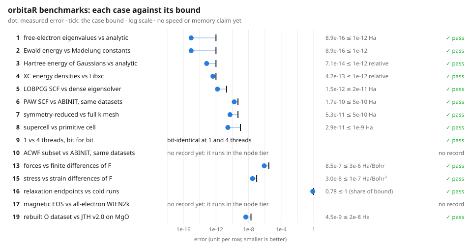

# Benchmark results

Generated by `cargo xtask results render` from [RESULTS.toml](RESULTS.toml); edit no line by hand.
Each row comes from one record; RESULTS.toml keeps its commit, its engine sha256 and every bound.
A row shows its case's headline metric: of those that results-what.toml names, the nearest to its bound.
No claim-tier row: these results make no speed or memory claim.

<picture>
  <source media="(prefers-color-scheme: dark)" srcset="../assets/benchmarks/results-dark.svg">
  
</picture>

## push tier

| case | what | metric | measured | bound | unit | outcome | commit |
|---|---|---|---|---|---|---|---|
| 1 `free_electron` | free-electron eigenvalues vs analytic | `eigenvalue_error_ha` | 8.9e-16 | ≤ 1e-12 | Ha | pass | 631c179 |
| 2 `ewald_madelung` | Ewald energy vs Madelung constants | `madelung_error` | 8.9e-16 | ≤ 1e-12 |  | pass | 631c179 |
| 3 `hartree_gaussians` | Hartree energy of Gaussians vs analytic | `hartree_relative_error` | 7.1e-14 | ≤ 1e-12 | relative | pass | 631c179 |
| 4 `xc_libxc` | XC energy densities vs Libxc | `xc_relative_error` | 4.2e-13 | ≤ 1e-12 | relative | pass | 631c179 |
| 5 `lobpcg_dense` | LOBPCG SCF vs dense eigensolver | `eigenvalue_difference_ha` | 1.5e-12 | ≤ 2e-11 | Ha | pass | 631c179 |
| 19 `family_v0` | rebuilt O dataset vs JTH v2.0 on MgO | `term_difference_ha` | 4.5e-9 | ≤ 2e-8 | Ha | pass | 631c179 |

## pr tier

| case | what | metric | measured | bound | unit | outcome | commit |
|---|---|---|---|---|---|---|---|
| 6 `abinit_jth` | PAW SCF vs ABINIT, same datasets | `free_energy_error_ha` | 1.7e-10 | ≤ 5e-10 | Ha | pass | 631c179 |
| 7 `symmetry` | symmetry-reduced vs full k mesh | `term_difference_ha` | 5.3e-11 | ≤ 5e-10 | Ha | pass | 631c179 |
| 8 `supercell_invariance` | supercell vs primitive cell | `term_difference_ha` | 2.9e-11 | ≤ 1e-9 | Ha | pass | 631c179 |
| 9 `thread_invariance` | 1 vs 4 threads, bit for bit | `term_difference_ha` | 0 | ≤ 0 |  | pass | 631c179 |
| 13 `forces_derivative` | forces vs finite differences of F | `fe_pbe_force_difference_ha_bohr` | 8.5e-7 | ≤ 3e-6 | Ha/Bohr | pass | 631c179 |
| 15 `stress_derivative` | stress vs strain differences of F | `gaas_volume_stress_difference_ha_bohr3` | 3.0e-8 | ≤ 1e-7 | Ha/Bohr³ | pass | 631c179 |
| 16 `relax_endpoint` | relaxation endpoints vs cold runs | `si_cell_fmax_share` | 0.78 | ≤ 1 | (share of bound) | pass | 631c179 |
| 20 `abinit_r2scan` | r2SCAN PAW SCF vs ABINIT, same datasets | `free_energy_error_ha` | 2.0e-10 | ≤ 5e-10 | Ha | pass | 631c179 |

## nightly tier

| case | what | metric | measured | bound | unit | outcome | commit |
|---|---|---|---|---|---|---|---|
| 21 `symmetry_r2scan` | r2SCAN symmetry-reduced vs full k mesh | `term_difference_ha` | 2.0e-11 | ≤ 5e-10 | Ha | pass | 631c179 |
| 22 `r2scan_derivatives` | r2SCAN stress vs strain differences of F | `gaas_stress_difference_ha_bohr3` | 2.6e-10 | ≤ 2e-9 | Ha/Bohr³ | pass | 631c179 |

## node tier

| case | what | metric | measured | bound | unit | outcome | commit |
|---|---|---|---|---|---|---|---|
| 10 `acwf_subset` | ACWF subset vs ABINIT, same datasets |  | |  | eV | no record | none |
| 17 `magnetic_ae` | magnetic EOS vs all-electron WIEN2k |  | |  | meV/atom | no record | none |
